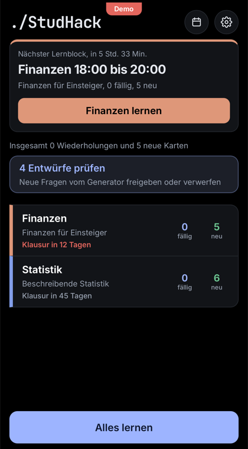
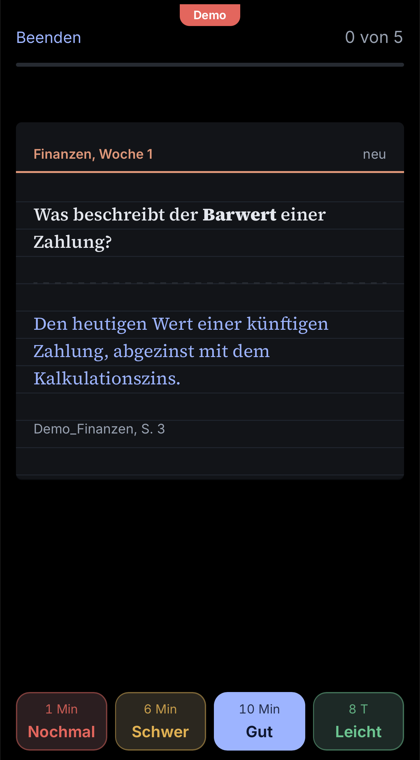
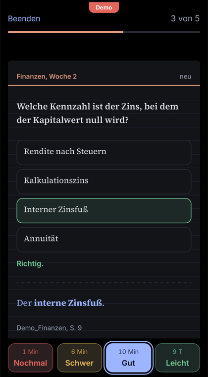
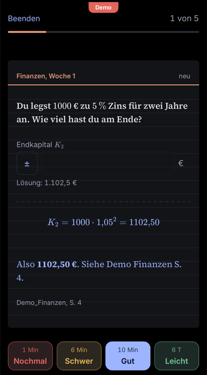
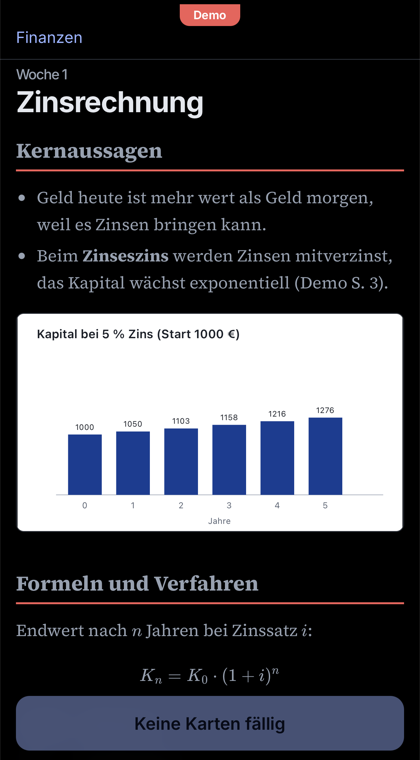
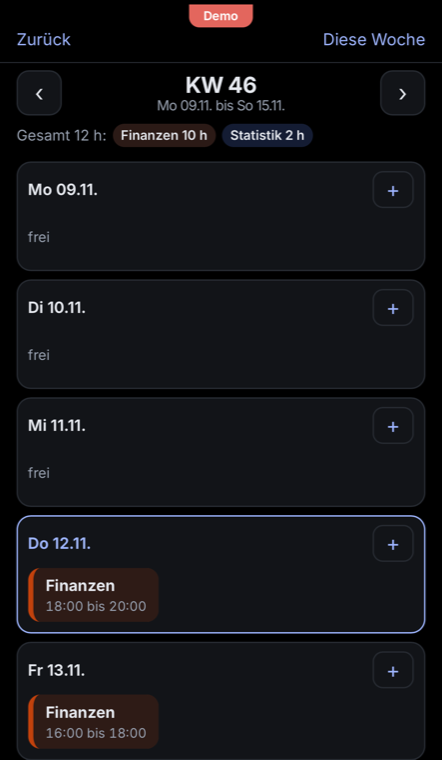
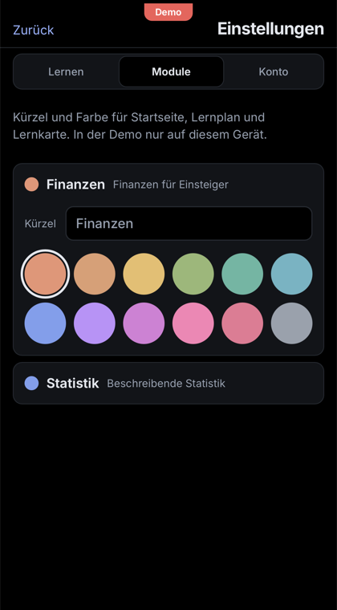
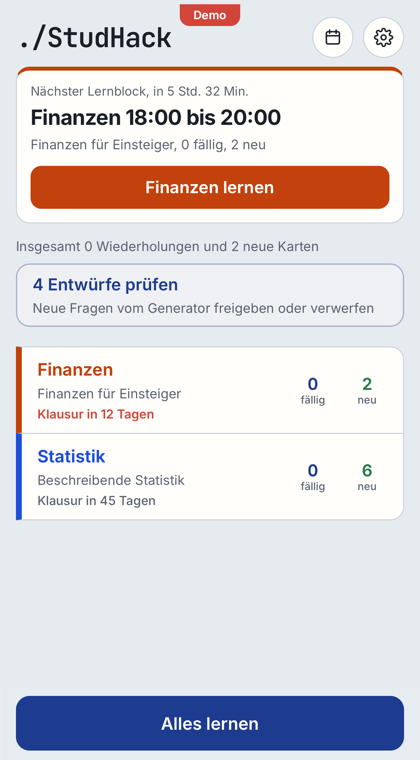
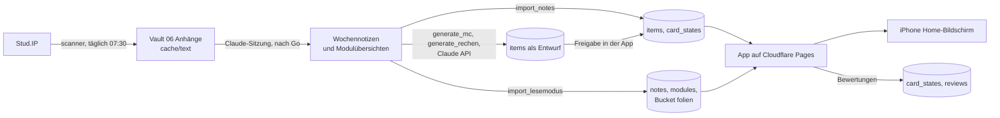

<p>
  <a href="README.en.md"></a>
  <a href="README.de.md"></a>
</p>

# ./StudHack

Lernassistent fürs Studium: lädt Materialien aus Stud.IP, macht daraus mit Claude
Wochennotizen in einem Obsidian-Vault und bringt Notizen, Karteikarten,
Auswahlfragen und Rechenaufgaben in eine Lern-App (PWA) mit Spaced Repetition.
Entstanden für ein Studium an der MLU Halle, läuft aber mit jeder Stud.IP-Instanz,
die die JSON:API anbietet.

**[Demo ausprobieren](https://studhack.pages.dev)**: auf der Anmeldeseite
"Demo ausprobieren" tippen. Die Demo läuft ohne Konto mit Beispielinhalten, alles
bleibt auf deinem Gerät.

## Vorschau

<table>
  <tr>
    <td></td>
    <td></td>
    <td></td>
    <td></td>
  </tr>
  <tr>
    <td></td>
    <td></td>
    <td></td>
    <td></td>
  </tr>
</table>

## Funktionen

- **Stud.IP-Scanner:** täglich um 07:30 neue Dateien laden, Mitteilung am Mac nur bei Neuem.
- **Wochennotizen:** Claude fasst die neuen Folien in einer Sitzung zusammen, du gibst sie vorher frei.
- **Lernen mit FSRS:** Karteikarten, Verständnisfragen, Auswahlfragen und Rechenaufgaben mit Zahleneingabe und Toleranz.
- **Generator:** Auswahlfragen und Rechenaufgaben mit Claude, jede Frage in einem zweiten Aufruf gegen Notiz und Folie geprüft. Neue Fragen sind Entwürfe, bis du sie freigibst.
- **Lesemodus:** Wochennotizen mit Folienbildern, Formeln (KaTeX) und Diagrammen (Mermaid).
- **Lernplan:** 2-Stunden-Blöcke je Woche, Vorschlag nach Klausurnähe, Klausur-Countdown.
- **Mitteilungen:** Web-Push für Blockbeginn, Morgenüberblick, offene Wiederholungen und neue Entwürfe.
- **Offline:** Karten, Notizen und Folienbilder bleiben auf dem Gerät, Bewertungen werden später gesendet.
- **Eigene Kürzel und Farben** je Modul, heller und dunkler Modus.

## Ablauf



`wochenlauf` führt die Schritte aus den Wochennotizen nacheinander aus.

## Bausteine

| Baustein | Einstieg | Aufgabe |
|---|---|---|
| Scanner | `scanner/scan.py` | Gleicht Stud.IP (nur lesend) mit `state/state.json` ab, lädt Neues nach `<Vault>/06 Anhänge/<Kürzel>/`, Text pro PDF-Seite nach `cache/text/`, Bericht nach `reports/` |
| Täglicher Scan | `scanner/auto.py`, `scripts/scan_einrichten.sh` | launchd-Job um 07:30, macOS-Mitteilung nur bei Neuem oder Fehlern, Protokoll in `logs/` |
| Karten-Importer | `importer/import_notes.py` | Karteikarten (`Frage::Antwort`) und Verständnisfragen (fette Frage plus `> [!question]-` Callout) nach `items` und `card_states`. Erkennt Karten am Hash von Modul, Typ und Frage |
| Lesemodus-Importer | `importer/import_lesemodus.py` | Wochennotizen ohne Karteikarten-Abschnitt nach `notes`, Modulübersichten nach `modules` (mit Klausurtermin aus `config.yaml`), eingebettete Folienbilder als JPEG in den privaten Bucket `folien` |
| Generator | `generator/generate_mc.py` | Auswahlfragen mit Claude Sonnet, zweiter Aufruf prüft jede Frage gegen Notiz und Folientext, legt Bestandenes als Entwurf an |
| Rechenaufgaben | `generator/generate_rechen.py` | übernimmt Übungsaufgaben mit Zahlenergebnis aus den Wochennotizen samt Rechenweg, legt Eingabefelder mit Sollwert und Toleranz fest, prüft jeden Sollwert in einem zweiten Aufruf. Keine neuen Aufgaben |
| Wochenbefehl | `wochenlauf.py` | Vorschau (nur lesend), dann Karten-Importer, Lesemodus-Importer, Generator, Kalender |
| Kalender | `kalender.py` | Liest die Lernblöcke aus `study_blocks` und schreibt `<Vault>/02 Lernplan/Kalender.md` |
| Mitteilungen | `supabase/functions/erinnerungen/` | Edge Function, alle 5 Minuten per pg_cron: Web-Push an die angemeldeten Geräte, Ruhezeit 22 bis 7 Uhr, keine Doppelmeldungen |
| App | `app/` | Vite, React, TypeScript. Details in [`app/README.md`](app/README.md) |

Importer und Generator schreiben nur mit `--schreiben`, ohne die Option ist es ein
Trockenlauf (der Generator ruft mit `--notiz` oder `--modul` trotzdem die API auf).

Das Format der Wochennotizen legt die `CLAUDE.md` im eigenen Vault fest, sie ist
nicht Teil dieses Repositorys. Die Importer erwarten Karteikarten als
`Frage::Antwort` im Abschnitt Karteikarten, Verständnisfragen als fette Frage mit
`> [!question]-` Callout und Übungsaufgaben im Abschnitt Übungsaufgaben.

## Datenmodell (Supabase)

| Tabelle | Inhalt | Schreibt | Liest |
|---|---|---|---|
| `items` | Lernobjekte: Typ, Frage, Antwort, Optionen, Eingabefelder, Quelle, Modul, Woche, Status | Karten-Importer, Generator (Entwürfe), App (Freigabe) | App |
| `card_states` | FSRS-Zustand je Lernobjekt | Importer und Generator (Anlage), App | App |
| `reviews` | jede Bewertung | App | |
| `notes` | Wochennotizen als Markdown | Lesemodus-Importer | App |
| `modules` | Modulübersicht, voller Name, Klausurtermin | Lesemodus-Importer | App |
| `study_blocks` | Lernplan: 2-Stunden-Blöcke mit Modul, Tag, Uhrzeit, erledigt | App | App, Kalender |
| `push_subscriptions` | Geräte für Mitteilungen mit Schaltern je Art | App | Edge Function |
| `push_sent` | verschickte Mitteilungen gegen Doppelte | Edge Function | |
| `module_colors` | selbst gewählte Farbe und Kürzel je Modul | App (Einstellungen) | App |
| Bucket `folien` | Folienbilder, privat, `<user_id>/<Kürzel>/<Bild>.jpg` | Lesemodus-Importer | App (zeitlich begrenzte Links) |

Alle Tabellen haben Row Level Security: Jeder angemeldete Nutzer sieht nur eigene
Zeilen. Importer und Generator melden sich mit dem Nutzerkonto aus `.env` an
(`STUDHACK_EMAIL`, `STUDHACK_PASSWORD`), auf dem Mac gibt es keinen
service_role-Schlüssel. Nur die Edge Function erinnerungen nutzt den
Service-Schlüssel, den Supabase ihr selbst bereitstellt.

Migrationen in `supabase/migrations/`, in dieser Reihenfolge im SQL Editor ausführen:

1. `20261106120000_lernobjekte.sql`: items, card_states, reviews
2. `20261107120000_notizen.sql`: notes, Bucket folien
3. `20261108120000_module.sql`: modules
4. `20261109120000_auswahlfragen.sql`: Typ multiple_choice
5. `20261110120000_klausurtermine.sql`: Spalte exam_date in modules
6. `20261111120000_lernplan.sql`: study_blocks
7. `20261112120000_mitteilungen.sql`: push_subscriptions, push_sent
8. `20261113120000_mitteilungen_rechte.sql`: Leserechte der Edge Function erinnerungen
9. `20261114120000_rechenaufgaben.sql`: Spalte eingaben in items
10. `20261115120000_modulfarben.sql`: module_colors, selbst gewählte Modulfarben
11. `20261116120000_modulkuerzel.sql`: Spalte kuerzel in module_colors, eigene Kürzel je Modul

## Einrichtung

Voraussetzungen: macOS (für den täglichen Scan), Python 3.10 oder neuer (getestet mit 3.14),
Node 22, ein Supabase-Projekt im Gratis-Tarif, ein Cloudflare-Konto für die App
und ein Schlüssel für die Claude API (nur für den Generator).

```bash
git clone https://github.com/Gerhard-Wilhelm/StudHack.git Lernassistent
cd Lernassistent
python3 -m venv .venv
.venv/bin/pip install -r requirements.txt
cp .env.example .env
cp config.example.yaml config.yaml
chmod 600 .env
```

1. `.env` ausfüllen: Stud.IP-Zugang, Supabase-URL und Publishable Key, Login des
   Supabase-Nutzers, `ANTHROPIC_API_KEY`.
2. `config.yaml` anpassen: Stud.IP-URL, Vault-Pfad, deine Module mit Kurs-IDs
   (`.venv/bin/python -m scanner.scan --list-courses`) und Klausurterminen.
3. Supabase: Projekt anlegen, unter Authentication die Registrierung abschalten
   ("Allow new users to sign up"), deinen Nutzer von Hand anlegen und alle
   Migrationen ausführen.
4. App: `cd app && npm install`, `app/.env.local` mit `VITE_SUPABASE_URL` und
   `VITE_SUPABASE_KEY` (URL ohne `/rest/v1/`). Lokal starten mit `npm run dev`.
5. Cloudflare Pages: Repository verbinden, Root `app`, Build `npm run build`,
   Output `dist`, Variablen `VITE_SUPABASE_URL`, `VITE_SUPABASE_KEY`,
   `NODE_VERSION=22`. Jeder Merge nach `main` baut neu.
6. Täglicher Scan: `scripts/scan_einrichten.sh`.
7. Mitteilungen (optional): VAPID-Schlüssel erzeugen, Secrets `VAPID_PUBLIC_KEY`,
   `VAPID_PRIVATE_KEY`, `VAPID_SUBJECT`, `CRON_SECRET` bei Supabase setzen, Funktion
   `erinnerungen` deployen, `supabase/zeitplan_erinnerungen.sql` mit deinen Werten
   ausführen und `VITE_VAPID_PUBLIC_KEY` bei Cloudflare eintragen. Details in
   [`app/README.md`](app/README.md).
8. Erste Daten: `.venv/bin/python -m wochenlauf`.

## Konfiguration (`config.yaml`)

| Feld | Bedeutung |
|---|---|
| `studip_url` | Basis-URL der Stud.IP-Instanz |
| `vault` | Pfad zum Obsidian-Vault |
| `auswahlfragen` | Standardanzahl Auswahlfragen pro Notiz (`single`, `multiple`) |
| `module.<Kürzel>.name` | voller Modulname |
| `module.<Kürzel>.kurse` | Stud.IP-Kurs-IDs (`scanner.scan --list-courses`) |
| `module.<Kürzel>.pruefung` | gewählter Klausurtermin (YYYY-MM-DD) |
| `module.<Kürzel>.auswahlfragen` | eigene Anzahl Auswahlfragen für das Modul |
| `module.<Kürzel>.rechenaufgaben` | `false` schaltet Rechenaufgaben für das Modul ab |

## Befehle

```bash
.venv/bin/python -m scanner.scan --auth-test      # Stud.IP-Anmeldung prüfen
.venv/bin/python -m scanner.scan --list-courses   # belegte Kurse mit ID
.venv/bin/python -m scanner.scan --dry-run        # nur anzeigen, was neu ist
.venv/bin/python -m scanner.scan                  # neue Dateien laden
.venv/bin/python -m wochenlauf                    # Wochennotizen in die App
.venv/bin/python -m generator.generate_mc --notiz "STA W03"     # Probelauf einer Notiz
.venv/bin/python -m generator.generate_rechen --notiz "FIN W04" # Rechenaufgaben, Probelauf
scripts/scan_einrichten.sh                        # täglichen Scan einrichten
launchctl kickstart -k gui/$(id -u)/de.studhack.scan   # Scan sofort starten
```

## Kosten

Supabase, Cloudflare Pages und GitHub laufen im Gratis-Tarif. Kosten entstehen nur
durch die Claude API beim Generator, rund 0,15 Dollar je Wochennotiz für Auswahlfragen und Rechenaufgaben zusammen.

## Tests

```bash
.venv/bin/python -m unittest importer.test_import_lesemodus generator.test_generate_mc generator.test_generate_rechen scanner.test_auto test_wochenlauf test_kalender
cd app && npm test && npm run build
```

Die Tests brauchen weder Stud.IP noch Supabase noch die Claude API.

## Regeln

- Stud.IP nur lesend (GET) und nur mit deinen eigenen Zugangsdaten.
- Nie ins Repository: `.env`, `app/.env.local`, `config.yaml`, Folieninhalte, PDFs,
  extrahierte Texte, Vault-Notizen, `state/`, `reports/`, `cache/`, `logs/`.
  Folien und Skripte gehören deinen Lehrenden.
- Neue Lernobjekte vom Generator sind Entwürfe und kommen erst nach Freigabe in
  den Lernstapel.
- Arbeitsregeln für Claude Code in [`CLAUDE.md`](CLAUDE.md).

## Lizenz und Hinweis

[MIT](LICENSE). Privates Lernprojekt ohne Verbindung zur Martin-Luther-Universität
Halle-Wittenberg oder zu den Entwicklern von Stud.IP. Die Nutzung der Stud.IP-API
richtet sich nach den Regeln deiner Hochschule.
