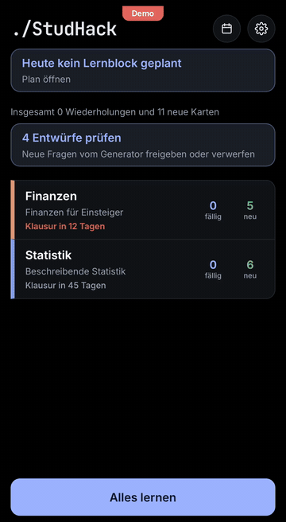
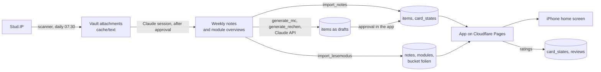

<p>
  <a href="README.en.md"></a>
  <a href="README.md"></a>
</p>

# ./StudHack

*The shortcut through your semester.*

A study assistant for university: it downloads course material from Stud.IP,
turns it into weekly notes in an Obsidian vault with Claude, and brings notes,
flashcards, multiple choice questions and calculation tasks into a study app (PWA)
with spaced repetition. Built for a degree at MLU Halle (Germany), but it works
with any Stud.IP instance that offers the JSON:API.

The app and the generated content are in German.

**[Try the demo](https://studhack.pages.dev)**: tap "Demo ausprobieren" on the
login screen. The demo needs no account, uses sample content and keeps everything
on your device.

## Preview

<p align="center">
  
</p>

## Features

- **Stud.IP scanner:** downloads new files every day at 07:30, with a Mac notification only when something is new.
- **Weekly notes:** Claude summarizes the new slides in a session, you approve them first.
- **Spaced repetition with FSRS:** flashcards, open questions, multiple choice and calculation tasks with number input and tolerance.
- **Generator:** multiple choice questions and calculation tasks written by Claude, each one checked against note and slide in a second call. New questions stay drafts until you approve them.
- **Reading mode:** weekly notes with slide images, formulas (KaTeX) and diagrams (Mermaid).
- **Study plan:** 2 hour blocks per week, suggestions based on exam dates, exam countdown.
- **Notifications:** web push for block start, morning overview, open reviews and new drafts.
- **Offline:** cards, notes and slide images stay on the device, reviews are sent later.
- **Custom names and colors** per module, light and dark mode.

## Flow



`wochenlauf` runs all steps after the weekly notes in one go.

## Components

| Component | Entry point | Purpose |
|---|---|---|
| Scanner | `scanner/scan.py` | Compares Stud.IP (read only) with `state/state.json`, downloads new files to `<vault>/06 Anhänge/<module>/`, text per PDF page to `cache/text/`, report to `reports/` |
| Daily scan | `scanner/auto.py`, `scripts/scan_einrichten.sh` | launchd job at 07:30, macOS notification only for new files or errors, log in `logs/` |
| Card importer | `importer/import_notes.py` | Flashcards (`question::answer`) and open questions (bold question plus `> [!question]-` callout) into `items` and `card_states`. Identifies cards by a hash of module, type and question |
| Reading mode importer | `importer/import_lesemodus.py` | Weekly notes without the flashcard section into `notes`, module overviews into `modules` (with exam date from `config.yaml`), embedded slide images as JPEG into the private bucket `folien` |
| Generator | `generator/generate_mc.py` | Multiple choice questions with Claude Sonnet, a second call checks each one against note and slide text, passing questions become drafts |
| Calculation tasks | `generator/generate_rechen.py` | Takes exercises with a numeric result from the weekly notes including the worked solution, defines input fields with target value and tolerance, checks every target value in a second call. No new tasks |
| Weekly command | `wochenlauf.py` | Preview (read only), then card importer, reading mode importer, generator, calendar |
| Calendar | `kalender.py` | Reads study blocks from `study_blocks` and writes `<vault>/02 Lernplan/Kalender.md` |
| Notifications | `supabase/functions/erinnerungen/` | Edge Function, every 5 minutes via pg_cron: web push to registered devices, quiet hours 22:00 to 07:00, no duplicates |
| App | `app/` | Vite, React, TypeScript. Details in [`app/README.md`](app/README.md) (German) |

Importers and generator only write with `--schreiben`. Without it they do a dry
run (the generator still calls the API with `--notiz` or `--modul`).

The format of the weekly notes is defined by the `CLAUDE.md` in your own vault,
which is not part of this repository. The importers expect flashcards as
`question::answer` in the section "Karteikarten", open questions as a bold question
with a `> [!question]-` callout, and exercises in the section "Übungsaufgaben".

## Data model (Supabase)

| Table | Content | Written by | Read by |
|---|---|---|---|
| `items` | Learning objects: type, question, answer, options, input fields, source, module, week, status | Card importer, generator (drafts), app (approval) | App |
| `card_states` | FSRS state per learning object | Importers and generator (creation), app | App |
| `reviews` | every rating | App | |
| `notes` | weekly notes as Markdown | Reading mode importer | App |
| `modules` | module overview, full name, exam date | Reading mode importer | App |
| `study_blocks` | study plan: 2 hour blocks with module, day, time, done | App | App, calendar |
| `push_subscriptions` | devices for notifications with a switch per type | App | Edge Function |
| `push_sent` | sent notifications, to avoid duplicates | Edge Function | |
| `module_colors` | custom color and short name per module | App (settings) | App |
| Bucket `folien` | slide images, private, `<user_id>/<module>/<image>.jpg` | Reading mode importer | App (signed links) |

All tables use Row Level Security: every signed in user only sees their own rows.
Importers and generator sign in with the account from `.env` (`STUDHACK_EMAIL`,
`STUDHACK_PASSWORD`), there is no service_role key on the Mac. Only the Edge
Function `erinnerungen` uses the service key that Supabase provides to it.

Migrations live in `supabase/migrations/`. Run them in this order in the SQL editor:

1. `20261106120000_lernobjekte.sql`: items, card_states, reviews
2. `20261107120000_notizen.sql`: notes, bucket folien
3. `20261108120000_module.sql`: modules
4. `20261109120000_auswahlfragen.sql`: type multiple_choice
5. `20261110120000_klausurtermine.sql`: column exam_date in modules
6. `20261111120000_lernplan.sql`: study_blocks
7. `20261112120000_mitteilungen.sql`: push_subscriptions, push_sent
8. `20261113120000_mitteilungen_rechte.sql`: read access for the Edge Function erinnerungen
9. `20261114120000_rechenaufgaben.sql`: column eingaben in items
10. `20261115120000_modulfarben.sql`: module_colors, custom module colors
11. `20261116120000_modulkuerzel.sql`: column kuerzel in module_colors, custom short names

## Setup

Requirements: macOS (for the daily scan), Python 3.10 or newer (tested with 3.14),
Node 22, a free Supabase project, a Cloudflare account for the app and a Claude API
key (only for the generator).

```bash
git clone https://github.com/Gerhard-Wilhelm/StudHack.git Lernassistent
cd Lernassistent
python3 -m venv .venv
.venv/bin/pip install -r requirements.txt
cp .env.example .env
cp config.example.yaml config.yaml
chmod 600 .env
```

1. Fill in `.env`: Stud.IP login, Supabase URL and publishable key, login of your
   Supabase user, `ANTHROPIC_API_KEY`.
2. Edit `config.yaml`: Stud.IP URL, vault path, your modules with course IDs
   (`.venv/bin/python -m scanner.scan --list-courses`) and exam dates.
3. Supabase: create a project, turn off sign ups under Authentication ("Allow new
   users to sign up"), create your user by hand and run all migrations.
4. App: `cd app && npm install`, create `app/.env.local` with `VITE_SUPABASE_URL`
   and `VITE_SUPABASE_KEY` (URL without `/rest/v1/`). Start locally with `npm run dev`.
5. Cloudflare Pages: connect the repository, root `app`, build `npm run build`,
   output `dist`, variables `VITE_SUPABASE_URL`, `VITE_SUPABASE_KEY`,
   `NODE_VERSION=22`. Every merge into `main` triggers a build.
6. Daily scan: `scripts/scan_einrichten.sh`.
7. Notifications (optional): create VAPID keys, set the secrets `VAPID_PUBLIC_KEY`,
   `VAPID_PRIVATE_KEY`, `VAPID_SUBJECT`, `CRON_SECRET` in Supabase, deploy the
   function `erinnerungen`, run `supabase/zeitplan_erinnerungen.sql` with your values
   and add `VITE_VAPID_PUBLIC_KEY` in Cloudflare. Details in
   [`app/README.md`](app/README.md).
8. First data: `.venv/bin/python -m wochenlauf`.

## Configuration (`config.yaml`)

| Field | Meaning |
|---|---|
| `studip_url` | base URL of the Stud.IP instance |
| `vault` | path to the Obsidian vault |
| `auswahlfragen` | default number of multiple choice questions per note (`single`, `multiple`) |
| `module.<id>.name` | full module name |
| `module.<id>.kurse` | Stud.IP course IDs (`scanner.scan --list-courses`) |
| `module.<id>.pruefung` | chosen exam date (YYYY-MM-DD) |
| `module.<id>.auswahlfragen` | custom number of multiple choice questions for this module |
| `module.<id>.rechenaufgaben` | `false` turns off calculation tasks for this module |

## Commands

```bash
.venv/bin/python -m scanner.scan --auth-test      # check the Stud.IP login
.venv/bin/python -m scanner.scan --list-courses   # enrolled courses with ID
.venv/bin/python -m scanner.scan --dry-run        # only show what is new
.venv/bin/python -m scanner.scan                  # download new files
.venv/bin/python -m wochenlauf                    # weekly notes into the app
.venv/bin/python -m generator.generate_mc --notiz "STA W03"     # trial run for one note
.venv/bin/python -m generator.generate_rechen --notiz "FIN W04" # calculation tasks, trial run
scripts/scan_einrichten.sh                        # set up the daily scan
launchctl kickstart -k gui/$(id -u)/de.studhack.scan   # run the scan now
```

## Costs

Supabase, Cloudflare Pages and GitHub run on free tiers. The only cost is the
Claude API used by the generator, about 0.15 dollars per weekly note for multiple
choice and calculation tasks together.

## Tests

```bash
.venv/bin/python -m unittest importer.test_import_lesemodus generator.test_generate_mc generator.test_generate_rechen scanner.test_auto test_wochenlauf test_kalender
cd app && npm test && npm run build
```

The tests need neither Stud.IP nor Supabase nor the Claude API.

## Rules

- Stud.IP is accessed read only (GET) and only with your own credentials.
- Never commit: `.env`, `app/.env.local`, `config.yaml`, slide content, PDFs,
  extracted text, vault notes, `state/`, `reports/`, `cache/`, `logs/`. Slides and
  scripts belong to your lecturers.
- New learning objects from the generator are drafts until you approve them.
- Working rules for Claude Code are in [`CLAUDE.md`](CLAUDE.md) (German).

## License and notice

[MIT](LICENSE). Personal study project, not affiliated with Martin Luther
University Halle-Wittenberg or the developers of Stud.IP. Use of the Stud.IP API
is subject to the rules of your university.
