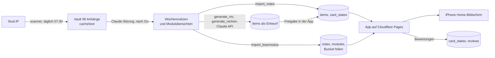

# Lernassistent

Persönlicher Lernassistent für das Studium an der MLU Halle: lädt Materialien aus
Stud.IP, macht daraus mit Claude Wochennotizen in einem Obsidian-Vault und bringt
Notizen, Karteikarten, Auswahlfragen und Rechenaufgaben in eine Lern-App (PWA) mit Spaced
Repetition. Die Bedienungsanleitung steht im Vault unter
`00 Kontext/Lernassistent Anleitung.md`, die Regeln für Claude in `CLAUDE.md`.

## Ablauf



`wochenlauf` führt die drei Schritte aus den Wochennotizen nacheinander aus.

## Bausteine

| Baustein | Einstieg | Aufgabe |
|---|---|---|
| Scanner | `scanner/scan.py` | Gleicht Stud.IP (nur lesend) mit `state/state.json` ab, lädt Neues nach `<Vault>/06 Anhänge/<Kürzel>/`, Text pro PDF-Seite nach `cache/text/`, Bericht nach `reports/` |
| Täglicher Scan | `scanner/auto.py`, `scripts/scan_einrichten.sh` | launchd-Job um 07:30, macOS-Mitteilung nur bei Neuem oder Fehlern, Protokoll in `logs/` |
| Karten-Importer | `importer/import_notes.py` | Karteikarten (`Frage::Antwort`) und Verständnisfragen (fette Frage plus `> [!question]-` Callout) nach `items` (Status freigegeben) und `card_states`. Erkennt Karten am Hash von Modul, Typ und Frage |
| Lesemodus-Importer | `importer/import_lesemodus.py` | Wochennotizen ohne Karteikarten-Abschnitt nach `notes`, Modulübersichten ohne Wochen und Offene Fragen nach `modules` (mit Klausurtermin aus `config.yaml`), eingebettete Folienbilder als JPEG (max. 1400 px) in den privaten Bucket `folien` |
| Generator | `generator/generate_mc.py` | Auswahlfragen mit Claude Sonnet 5.5, zweiter Aufruf prüft jede Frage gegen Notiz und Folientext, legt Bestandenes als Entwurf an. Gestreamt, mit Wiederholung bei Verbindungsabbruch |
| Rechenaufgaben | `generator/generate_rechen.py` | übernimmt die Übungsaufgaben mit Zahlenergebnis aus den Wochennotizen samt Rechenweg, legt Eingabefelder mit Sollwert und Toleranz fest, zweiter Aufruf prüft jeden Sollwert gegen die Lösung in der Notiz. Keine neuen Aufgaben |
| Wochenbefehl | `wochenlauf.py` | Vorschau (nur lesend), dann Karten-Importer, Lesemodus-Importer, Generator, Kalender |
| Kalender | `kalender.py` | Liest die Lernblöcke aus `study_blocks` (nur lesend) und schreibt `<Vault>/02 Lernplan/Kalender.md`, läuft beim täglichen Scan und bei `wochenlauf` |
| Mitteilungen | `supabase/functions/erinnerungen/` | Edge Function, alle 5 Minuten per pg_cron: Web-Push an die angemeldeten Geräte (Blockbeginn, Morgenüberblick, offene Wiederholungen, Wochenplan fehlt, neue Entwürfe), Ruhezeit 22 bis 7 Uhr, keine Doppelmeldungen |
| App | `app/` | Vite, React, TypeScript. Login, Startseite mit Klausur-Countdown, Lernplan mit verschiebbaren Blöcken, Wochenliste, Lesemodus, Lernen mit FSRS (ts-fsrs), Auswahlfragen, Rechenaufgaben mit Zahleneingabe, Freigabe-Liste, Offline-Modus, Demo-Modus. Details in `app/README.md` |

Importer und Generator schreiben nur mit `--schreiben`, ohne die Option ist es ein
Trockenlauf (der Generator ruft mit `--notiz` oder `--modul` trotzdem die API auf).

## Datenmodell (Supabase)

| Tabelle | Inhalt | Schreibt | Liest |
|---|---|---|---|
| `items` | Lernobjekte: Typ, Frage, Antwort, Optionen, Eingabefelder (Rechenaufgaben), Quelle, Modul, Woche, Status | Karten-Importer, Generator (Entwürfe), App (Freigabe) | App |
| `card_states` | FSRS-Zustand je Lernobjekt | Importer und Generator (Anlage), App | App |
| `reviews` | jede Bewertung | App | |
| `notes` | Wochennotizen als Markdown | Lesemodus-Importer | App |
| `modules` | Modulübersicht, voller Name, Klausurtermin | Lesemodus-Importer | App |
| `study_blocks` | Lernplan: 2-Stunden-Blöcke mit Modul, Tag, Uhrzeit, erledigt | App | App, Kalender |
| `push_subscriptions` | Geräte für Mitteilungen mit Schaltern je Art | App | Edge Function |
| `module_colors` | selbst gewählte Farbe je Modul | App (Einstellungen) | App |
| `push_sent` | verschickte Mitteilungen gegen Doppelte | Edge Function | |
| Bucket `folien` | Folienbilder, privat, `<user_id>/<Kürzel>/<Bild>.jpg` | Lesemodus-Importer | App (zeitlich begrenzte Links) |

Alle Tabellen haben Row Level Security: Jeder angemeldete Nutzer sieht nur
eigene Zeilen. Importer und Generator melden sich als Gerhard an (`STUDHACK_EMAIL`,
`STUDHACK_PASSWORD`), auf dem Mac gibt es keinen service_role-Schlüssel. Nur die
Edge Function erinnerungen nutzt den Service-Schlüssel, den Supabase ihr selbst
bereitstellt.

Migrationen in `supabase/migrations/`, in dieser Reihenfolge im SQL Editor ausführen:

1. `20261106120000_lernobjekte.sql`: items, card_states, reviews
2. `20261107120000_notizen.sql`: notes, Bucket folien
3. `20261108120000_module.sql`: modules
4. `20261109120000_auswahlfragen.sql`: Typ multiple_choice
5. `20261110120000_klausurtermine.sql`: Spalte exam_date in modules
6. `20261111120000_lernplan.sql`: study_blocks
7. `20261112120000_mitteilungen.sql`: push_subscriptions, push_sent
8. `20261113120000_mitteilungen_rechte.sql`: Leserechte der Edge Function erinnerungen
9. `20261114120000_rechenaufgaben.sql`: Spalte eingaben in items
10. `20261115120000_modulfarben.sql`: module_colors, selbst gewählte Modulfarben

## Einrichtung von null

```bash
cd ~/StudHack/Lernassistent
python3 -m venv .venv
.venv/bin/pip install -r requirements.txt
cp .env.example .env
chmod 600 .env
```

1. `.env` ausfüllen: Stud.IP (Uni-Kennung und Passwort), Supabase-URL und
   Publishable Key, Login des Supabase-Nutzers, `ANTHROPIC_API_KEY`.
2. Supabase: Projekt im Gratis-Tarif (Frankfurt), Registrierung aus, Nutzer unter
   Authentication anlegen, alle Migrationen ausführen.
3. App: `cd app && npm install`, `app/.env.local` mit `VITE_SUPABASE_URL` und
   `VITE_SUPABASE_KEY` (URL ohne `/rest/v1/`).
4. Cloudflare Pages: Repository verbinden, Root `app`, Build `npm run build`,
   Output `dist`, Variablen `VITE_SUPABASE_URL`, `VITE_SUPABASE_KEY`,
   `NODE_VERSION=22`. Jeder Merge nach `main` baut neu.
5. Täglicher Scan: `scripts/scan_einrichten.sh`.
6. Mitteilungen (optional): Schritte in der Anleitung im Vault, Abschnitt "Mitteilungen einrichten".
7. Erste Daten: `.venv/bin/python -m wochenlauf`.

## Konfiguration (`config.yaml`)

| Feld | Bedeutung |
|---|---|
| `studip_url` | Basis-URL der Stud.IP-Instanz |
| `vault` | Pfad zum Obsidian-Vault |
| `auswahlfragen` | Standardanzahl Auswahlfragen pro Notiz (`single`, `multiple`) |
| `module.<Kürzel>.name` | voller Modulname |
| `module.<Kürzel>.kurse` | Stud.IP-Kurs-IDs (`scanner.scan --list-courses`) |
| `module.<Kürzel>.pruefung` | gewählter Klausurtermin (YYYY-MM-DD) |
| `module.<Kürzel>.auswahlfragen` | eigene Anzahl Auswahlfragen für das Modul |
| `module.<Kürzel>.rechenaufgaben` | `false` schaltet Rechenaufgaben für das Modul ab |

## Befehle

```bash
.venv/bin/python -m scanner.scan --auth-test      # Stud.IP-Anmeldung prüfen
.venv/bin/python -m scanner.scan --list-courses   # belegte Kurse mit ID
.venv/bin/python -m scanner.scan --dry-run        # nur anzeigen, was neu ist
.venv/bin/python -m scanner.scan                  # neue Dateien laden
.venv/bin/python -m wochenlauf                    # Wochennotizen in die App
.venv/bin/python -m generator.generate_mc --notiz "MAK W03"   # Probelauf einer Notiz
.venv/bin/python -m generator.generate_rechen --notiz "IuF W04"   # Rechenaufgaben, Probelauf
scripts/scan_einrichten.sh                        # täglichen Scan einrichten
launchctl kickstart -k gui/$(id -u)/de.studhack.scan          # Scan sofort starten
```

Alle Befehle der Importer und des Generators stehen in ihren Kopfkommentaren.

## Tests

```bash
.venv/bin/python -m unittest importer.test_import_lesemodus generator.test_generate_mc generator.test_generate_rechen scanner.test_auto test_wochenlauf test_kalender
cd app && npm test && npm run build
```

Die Tests brauchen weder Stud.IP noch Supabase noch die Claude API.

## Regeln

- Stud.IP nur lesend (GET).
- Nie ins Repository: `.env`, `app/.env.local`, Folieninhalte, PDFs, extrahierte
  Texte, Vault-Notizen, `state/`, `reports/`, `cache/`, `logs/`.
- Neue Lernobjekte vom Generator sind Entwürfe und kommen erst nach Freigabe in
  den Lernstapel.
- Laufende Kosten nur durch die Claude API (Generator), sonst Gratis-Tarife.
- Mehr in `CLAUDE.md`.
