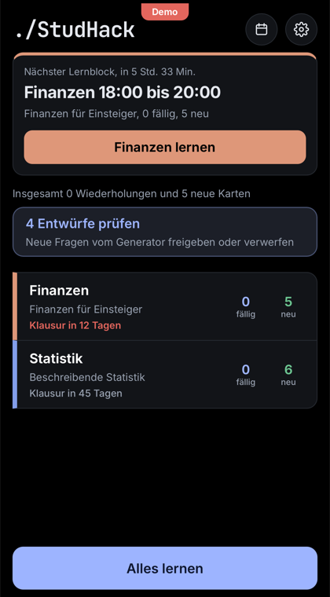
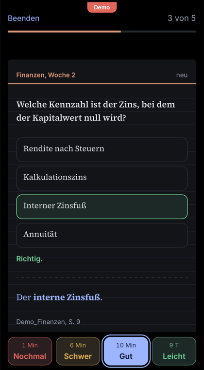
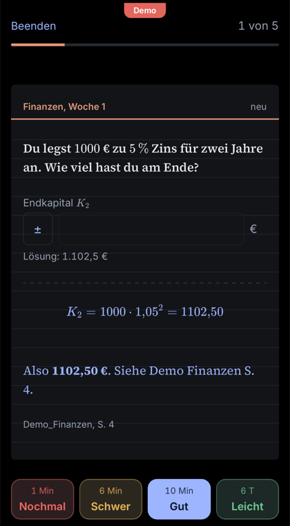
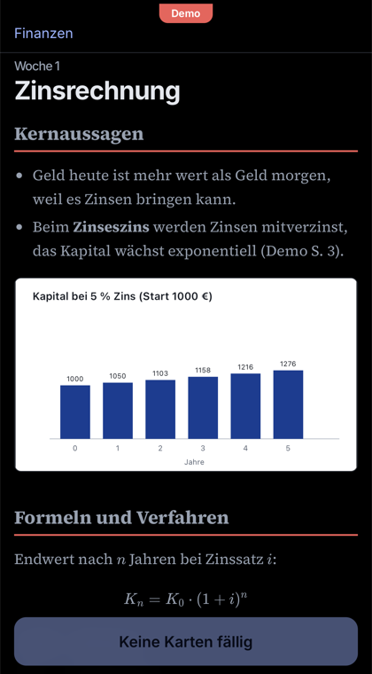
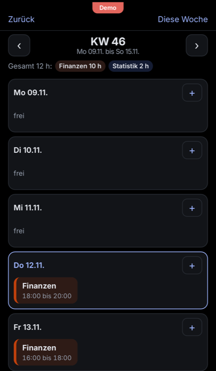
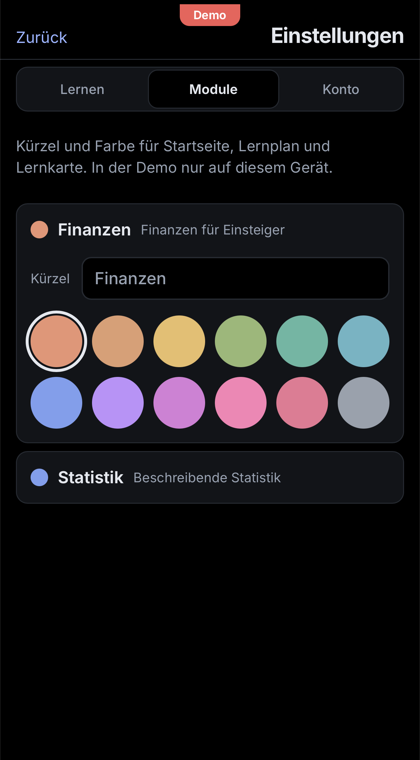
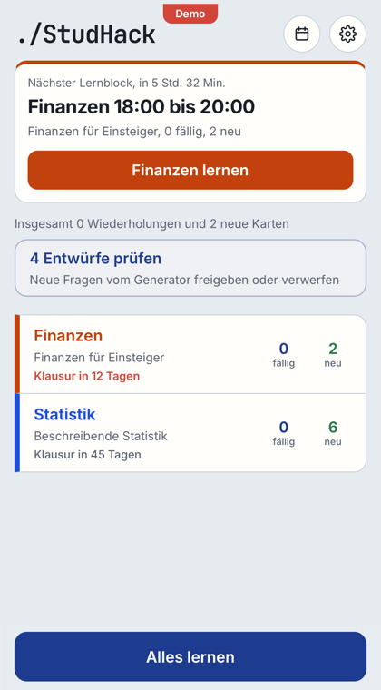
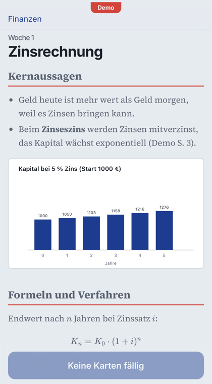

<h1 align="center">./StudHack</h1>

  Lern-App fürs Studium: Materialien aus Stud.IP, Wochennotizen mit Claude, Abfrage mit Spaced Repetition am Handy. 
  Study app for university: course material from Stud.IP, weekly notes written with Claude, spaced repetition on your phone.

  
  

  <a href="https://studhack.pages.dev"><b>Demo ausprobieren / Try the demo</b></a> 
  "Demo ausprobieren" auf der Startseite tippen, keine Anmeldung nötig. Tap "Demo ausprobieren" on the login screen, no account needed.

<table align="center">
  <tr>
    <td></td>
    <td></td>
    <td></td>
    <td></td>
  </tr>
  <tr>
    <td></td>
    <td></td>
    <td></td>
    <td></td>
  </tr>
</table>

MIT License. Privates Lernprojekt ohne Verbindung zur MLU Halle oder zu Stud.IP. Personal project, not affiliated with MLU Halle or Stud.IP.

